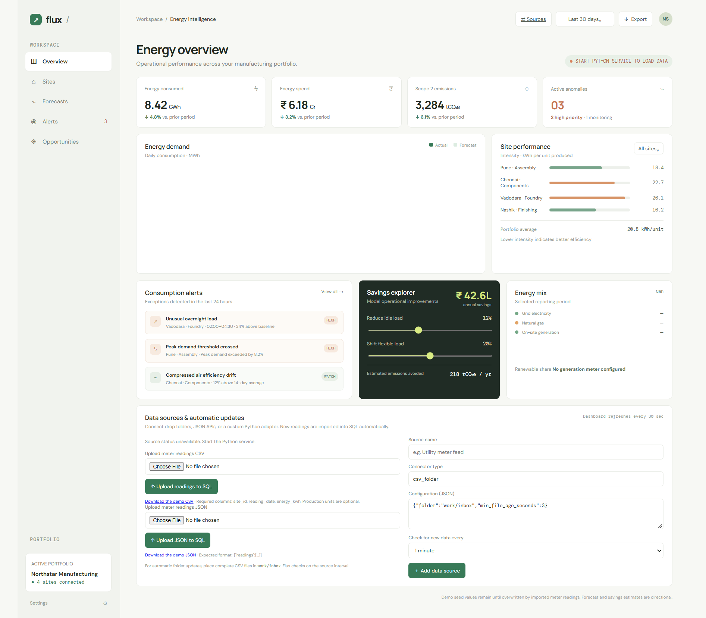

# Industrial Energy Optimisation & Carbon Intelligence

<p align="center">
  <strong>Flux – Industrial Energy Intelligence</strong><br>
  An end-to-end industrial analytics application for energy monitoring,
  demand forecasting, anomaly detection, carbon intelligence and
  operational optimisation.
</p>

<p align="center">
  
  
  
  
</p>

---

## 1. Project Overview

**Flux – Industrial Energy Intelligence** is a Python-based industrial analytics application designed to help manufacturing facilities monitor energy consumption, identify abnormal usage patterns, forecast energy demand and evaluate potential cost and carbon savings.

The application combines a browser-based interactive dashboard, Python analytics, SQLite database management and automated data ingestion.

It simulates a multi-site industrial environment and provides a practical framework for understanding how data analytics can support energy efficiency and sustainable manufacturing.

### Key Objectives

- Monitor industrial energy consumption across multiple facilities.
- Analyse electricity and gas consumption patterns.
- Forecast short-term energy demand.
- Detect abnormal energy consumption.
- Estimate operational energy costs.
- Calculate Scope 2 carbon emissions.
- Evaluate energy optimisation scenarios.
- Automate data collection and database updates.

---

## 2. Dashboard Preview

### Flux – Industrial Energy Intelligence

The project includes a locally hosted interactive dashboard that connects directly to the SQLite database.

**Dashboard features:**

| Module | Functionality |
|---|---|
| Energy Monitoring | Track energy consumption across industrial sites |
| Energy Forecasting | Generate a seven-day energy demand outlook |
| Anomaly Detection | Identify unusual energy consumption |
| Cost Intelligence | Estimate electricity and gas expenditure |
| Carbon Intelligence | Calculate estimated Scope 2 emissions |
| Site Performance | Compare energy intensity across facilities |
| Optimisation Scenarios | Simulate potential energy and cost savings |
| Data Management | Upload readings and monitor automated sources |

### Dashboard Screenshot



---

## 3. Core Functionalities

### 3.1 Industrial Energy Monitoring

Monitor daily energy consumption across four demonstration facilities:

- Pune – Assembly
- Chennai – Components
- Vadodara – Foundry
- Nashik – Finishing

Analyse:
- Total energy consumption (kWh)
- Electricity and gas consumption
- Production output
- Energy intensity
- Site-level energy performance

### 3.2 Energy Demand Forecasting

The application generates a seven-day energy consumption forecast.

The forecasting methodology incorporates:
- Recent historical energy consumption.
- Linear trend estimation.
- Weekday-based consumption patterns.
- Historical daily energy averages.

This provides a short-term outlook to support operational planning.

### 3.3 Energy Anomaly Detection

Identify unusual energy consumption at individual industrial sites.

The application compares daily readings against the preceding 14-day baseline.

An observation is flagged when consumption exceeds the baseline by 2.2 standard deviations, subject to a minimum variation threshold.

Alert classifications:
- HIGH – Significant abnormal consumption.
- WATCH – Potentially unusual energy usage.

This helps identify possible inefficiencies and investigate unexpected energy demand.

### 3.4 Energy Cost Intelligence

Estimate industrial energy expenditure using configurable illustrative tariffs.

| Energy Source | Illustrative Rate |
|---|---:|
| Electricity | ₹7.35/kWh |
| Gas | ₹2.85/kWh |

Calculate estimated operating expenditure and understand how changes in energy consumption affect costs.

### 3.5 Carbon Emissions Intelligence

Estimate Scope 2 emissions associated with electricity consumption.

The application uses an illustrative grid emissions factor of 0.708 kg CO₂e/kWh.

Gas emissions are also estimated separately using an illustrative factor of 0.202 kg CO₂e/kWh.

These factors are demonstration assumptions, not verified location-specific reporting factors.

### 3.6 Energy Optimisation Scenarios

Evaluate potential savings through adjustable optimisation assumptions.

The application allows users to simulate:

- Idle energy reduction: 0–30%.
- Flexible load shifting: 0–40%.

Outputs include:
- Estimated annual cost savings.
- Estimated avoided emissions.
- Saved optimisation scenarios.

These are directional estimates rather than measured or guaranteed savings.

---

## 4. Automated Data Integration

Flux supports multiple data ingestion methods.

### CSV Upload

Upload industrial meter readings through the dashboard.

Expected columns:

```csv
site_id,reading_date,energy_kwh,production_units
1,2026-10-18,70400,15020
2,2026-10-18,66100,11930
```

### JSON Integration

Connect external HTTP JSON endpoints using the built-in connector.

### Automated CSV Monitoring

The application monitors the `work/inbox` directory for incoming CSV files.

Features include:
- Automatic file detection.
- Scheduled source checks.
- Duplicate ingestion prevention.
- Database record updates.
- Import history and error tracking.

### Custom Connectors

Additional connectors can be developed using the base connector interface.

Potential integrations include:
- Industrial IoT systems.
- Manufacturing Execution Systems (MES).
- Energy meters.
- Industrial historians.
- Utility data platforms.

---

## 5. Technology Stack

| Category | Technologies |
|---|---|
| Programming | Python 3.10+ |
| Database | SQLite |
| Backend | Python HTTP Server |
| Frontend | HTML, CSS, JavaScript |
| Data Processing | Python standard library |
| Data Integration | CSV, JSON, HTTP APIs |
| Forecasting | Trend and weekday-based forecasting |
| Anomaly Detection | Statistical threshold detection |
| Version Control | Git and GitHub |

**Note:** The current implementation does not require third-party Python packages.

---

## 6. Database Architecture

The application uses SQLite for persistent data storage.

### Database Tables

| Table | Purpose |
|---|---|
| sites | Industrial facility information |
| readings | Daily energy and production records |
| scenario_runs | Saved optimisation scenarios |
| data_sources | Connector configurations |
| ingestion_runs | Data ingestion audit history |
| source_items | Duplicate ingestion tracking |

The database schema is maintained in `schema.sql` and is initialised automatically when the application starts.

---

## 7. Project Structure

```text
4-industrial-energy-optimisation-carbon-intelligence/
│
├── connectors/
│   ├── base.py
│   ├── csv_folder.py
│   ├── http_json.py
│   └── custom_example.py.example
│
├── outputs/
│   ├── index.html
│   ├── demo_readings.csv
│   ├── demo_readings.json
│   └── dashboard.png
│
├── work/
│   └── flux.db
│
├── app.py
├── schema.sql
├── start.bat
├── .gitignore
└── README.md
```

*The database file is generated locally and may be excluded from Git tracking.*

---

## 8. Installation and Execution

### Requirements

- Python 3.10 or later.
- Windows, macOS or Linux.
- Modern web browser.

### Step 1: Clone Repository

```bash
git clone https://github.com/sm292/4-industrial-energy-optimisation-carbon-intelligence.git

cd 4-industrial-energy-optimisation-carbon-intelligence
```

### Step 2: Run the Application

**Windows:**

```bash
start.bat
```

Alternatively:

```bash
python app.py
```

### Step 3: Open Dashboard

Navigate to:

```text
http://127.0.0.1:8000
```

The application automatically initialises the SQLite database and generates demonstration readings on its first run.

The dashboard refreshes its data periodically.

---

## 9. API Endpoints

| Method | Endpoint | Description |
|---|---|---|
| GET | /api/health | Application health status |
| GET | /api/sites | List industrial facilities |
| GET | /api/dashboard?days=30 | Dashboard analytics |
| POST | /api/scenarios | Run optimisation scenario |
| POST | /api/readings/import | Import JSON readings |
| POST | /api/readings/import-csv | Import CSV readings |
| GET | /api/sources | List data connectors |
| POST | /api/sources | Register a data source |
| POST | /api/sources/{id}/sync | Trigger source synchronisation |
| GET | /api/ingestion/runs | View ingestion history |

---

## 10. Business Applications

This project demonstrates how industrial data analytics can support:

1. **Smart Manufacturing:** Monitor energy consumption across production facilities.
2. **Predictive Energy Management:** Forecast upcoming energy requirements.
3. **Operational Efficiency:** Identify abnormal energy usage and investigate inefficiencies.
4. **Cost Optimisation:** Estimate potential reductions in energy expenditure.
5. **Sustainable Manufacturing:** Evaluate carbon emissions and potential reduction opportunities.
6. **Industrial Digitalisation:** Integrate different data sources into a centralised monitoring platform.

---

## 11. Future Enhancements

Potential development opportunities include:

- Machine learning-based energy demand forecasting.
- Advanced anomaly detection using Isolation Forest and clustering.
- Production-aware energy optimisation.
- Real-time IoT sensor integration.
- Renewable energy and solar generation analytics.
- Power BI and Tableau integration.
- Multi-factory benchmarking.
- Cloud deployment and role-based access.
- Predictive maintenance using energy consumption patterns.

---

## 12. Important Data Disclaimer

This repository currently uses synthetic demonstration data generated by the application.

Energy tariffs and emissions factors are illustrative assumptions. Forecasts, anomaly alerts, cost estimates and savings scenarios should be validated against actual industrial measurements before operational or sustainability reporting decisions.

The application is intended as a local demonstration and is not configured as an internet-facing production service.

---

## 13. Skills Demonstrated

- Python Programming
- Industrial Data Analytics
- SQL and Database Management
- Energy Consumption Analysis
- Time-Series Forecasting
- Statistical Anomaly Detection
- Carbon Emissions Estimation
- Data Integration and Automation
- API Development
- Dashboard Development
- Operational Cost Analysis
- Sustainable Manufacturing Analytics

---

## 14. Author

**Sumit Mondal**

Data Analytics | Data Science | Machine Learning | Industrial AI

GitHub: [@sm292](https://github.com/sm292)

Project Repository:

[Industrial Energy Optimisation & Carbon Intelligence](https://github.com/sm292/4-industrial-energy-optimisation-carbon-intelligence)

---

<p align="center">
  <strong>Turning Industrial Data into Energy Intelligence.</strong>
</p>
